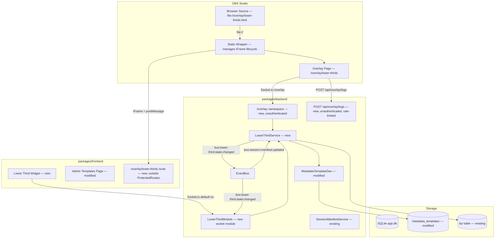

# Design Document — Lower Thirds

## Overview

This document extends the existing system design with a lower-third overlay capability. It covers the architecture, interfaces, data models, animation state machine, component specifications, and socket communication required to display animated lower-third graphics on a livestream via OBS.

This is an extension document — it references and builds on the original design docs at `.kiro/specs/livestream-control-system/design.md` and `.kiro/specs/multi-platform-streaming/design.md`. Patterns, conventions, and components defined there remain authoritative unless explicitly superseded here.

### What This Release Adds

- Static HTML overlay wrapper (`packages/overlay/lower-thirds.html`) for OBS `file://` loading
- Overlay React page (`/overlay/lower-thirds`) with Aspect Ratio Jail and animation engine
- Unauthenticated `/overlay` Socket.io namespace for display commands
- `LowerThirdService` — backend state management, auto-dismiss timers, transition locks
- `LowerThirdModule` — Socket.io gateway module for dashboard ↔ backend communication
- Overlay namespace handler — backend ↔ overlay communication
- Lower-third widget with swipe-to-reveal action pattern
- Extension of `metadata_templates` table for lower-third templates
- `POST /api/overlay/logs` — unauthenticated, rate-limited logging endpoint for the overlay
- Blue Rhombus animation style (entrance, exit, push-up, force-clear)
- Scripture pagination protocol (measure-on-add, cached page breaks, 10s timeout fallback)

### Breaking Changes

- **`metadata_templates` table**: `category` CHECK constraint expanded from `('title', 'description')` to `('title', 'description', 'lower_third')`. Two new nullable columns added: `lowerThirdType TEXT` and `autoDismissMs INTEGER`.
- **`MetadataTemplateDao`**: `TemplateCategory` type expanded. New methods for lower-third queries.
- **Admin Templates Page**: Third section added for lower-third templates.

### Steering Document Updates Required

This spec introduces patterns not yet documented in the steering doc. The following updates are required during implementation:

- **§3 (Interfaces & Boundaries)**: Add `file://` and `/overlay` namespace boundaries
- **§6 (Logging)**: Add `"overlay"` as a third `source` value
- **§7 (Event Naming)**: Add `sto:` and `ots:` prefix rows; add overlay namespace exception note
- **§10 (Responsive Sizing)**: Clarify rem applies to dashboard; overlay uses `cqw`/`cqh`

---

## Architecture

### Extended Topology



### Key Architectural Decisions

**Two-layer overlay (static wrapper + iFrame)**: The static HTML file is loaded via `file://` in OBS, making it immune to frontend/backend availability at OBS startup time. The iFrame loads the React page only when the frontend signals readiness via postMessage. This eliminates the need to refresh the OBS browser source after system startup.

**Unauthenticated `/overlay` namespace**: The overlay page runs in OBS with no user interaction — there's no way to log in. The `/overlay` namespace accepts connections without JWT but only emits display commands and accepts phase reports. No control commands are accepted on this namespace. The namespace enforces single-client: new connections forcibly disconnect the previous client.

**No Staged section, no confirmation step**: Rather than a persistent "Staged" queue, the library offers **Show** (animated) and swipe **Go Live** (`skipAnimation`), and both activate immediately. This keeps the widget to two sections instead of three and removes the confusion of "what does staged mean?" _(Revised: the original design put a Preview Dialog between Show and activation. The shipped behavior activates directly and that was confirmed as intended; the `PreviewDialog` component is built and tested but unused. Mistaken activations are recovered with Dismiss / Force Clear. The original reasoning for dropping the dialog was not recorded.)_

**Swipe-to-reveal actions**: Each row shows one primary button. Secondary actions are revealed by swiping. This reduces visual clutter while maintaining discoverability. The pattern is consistent across all rows.

**Force Clear bypasses everything**: The emergency clear action skips animation, ignores transition locks, and immediately hides the overlay. This is the "wrong content on screen" panic button.

**Backend owns all state**: The overlay is a pure renderer. The dashboard is a pure controller. The backend is the single source of truth.

**5-second fallback timeout**: If the overlay doesn't report phase completion, the backend advances state and notifies the dashboard. This prevents permanent lock-up from a crashed overlay.

---

## Backend Services

### LowerThirdService (New)

```typescript
interface LowerThirdService {
  // Library management
  getLibrary(): LowerThirdItem[];
  addToLibrary(input: AddLowerThirdInput): Result<LowerThirdItem, string>;
  removeFromLibrary(itemId: string): Result<void, string>;
  editLibraryItem(itemId: string, patch: EditLowerThirdInput): Result<LowerThirdItem, string>;

  // Activation (directly from library)
  // startPage (1-based, optional): activate on that page instead of page 1. Validated before any
  // state change; the library copy is never mutated (see "Show page" decisions below).
  activate(itemId: string, skipAnimation?: boolean, startPage?: number): Result<void, string>;
  dismissActive(): Result<void, string>;
  forceClear(): void; // always succeeds, bypasses lock

  // Pagination (scripture)
  pageNext(): Result<void, string>;
  pagePrevious(): Result<void, string>;

  // Phase tracking (called by overlay namespace handler)
  reportPhase(phase: AnimationPhase): void;
  reportPages(itemId: string, pages: PageBreakdown): void;

  // Overlay connection
  setOverlayConnected(connected: boolean): void;
  getPendingMeasurements(): LowerThirdItem[];
  handleResolutionReport(data: ResolutionReport): void;

  // State
  getFullState(): LowerThirdState;
  isTransitionLocked(): boolean;

  destroy(): void;
}
```

**Constructor dependencies**: `MetadataTemplateDao`, `Database` (for KJV queries), `SessionManifestService`.

**EventBus subscriptions**: `BUS_SESSION_MANIFEST_UPDATED` — recomputes template-derived library items.

**EventBus emissions**: `BUS_LOWER_THIRD_STATE_CHANGED` — emitted on any state change.

### Animation State Machine

```
                ┌────────────────────────────────────┐
                │                                    │
                ▼                                    │
  ┌────────┐  show   ┌─────────┐  overlay   ┌─────────┐
  │ hidden │────────▶│ showing │──reports──▶│ visible │
  └────────┘         └─────────┘            └─────────┘
       ▲                                        │
       │                                        │ dismiss / auto-dismiss
       │              ┌───────────┐             │
       └──────────────│ dismissing│◀────────────┘
          overlay     └───────────┘
          reports

  Force Clear: ANY state ──────────────────────▶ hidden (instant)
```

**Transition lock**: Locked when phase is `showing` or `dismissing`. Unlocked when `visible` or `hidden`. Force Clear bypasses the lock.

**Push-up**: `visible` → `showing` directly (no `dismissing` step). Overlay handles internally.

**5-second fallback**: If overlay doesn't report within 5s, backend advances phase and emits warning notification.

### Core Types

```typescript
type LowerThirdType = "Title" | "TitleSubtitle" | "Scripture";
type AnimationPhase = "hidden" | "showing" | "visible" | "dismissing";
type LowerThirdStyle = "blue_rhombus";

interface LowerThirdItem {
  id: string;
  type: LowerThirdType;
  style: LowerThirdStyle;
  content: TitleContent | TitleSubtitleContent | ScriptureContent;
  autoDismissMs: number | null;
  source: "template" | "volunteer";
  templateId: string | null;
  templateName: string | null;
  used: boolean;
  createdAt: string;
  pages: PageBreakdown | null;
}

interface TitleContent {
  title: string;
}
interface TitleSubtitleContent {
  title: string;
  subtitle: string;
}
interface ScriptureContent {
  reference: ScriptureReference;
  formattedReference: string;
  verses: VerseData[]; // always populated after successful add (Req 3.10 ensures KJV data exists)
}
interface VerseData {
  verseNumber: number;
  text: string;
}

interface PageBreakdown {
  totalPages: number;
  currentPage: number;
  pages: PageInfo[];
}
interface PageInfo {
  pageNumber: number;
  startVerse: number;
  endVerse: number;
}

interface LowerThirdState {
  active: LowerThirdItem | null;
  library: LowerThirdItem[];
  phase: AnimationPhase;
  autoDismissAt: string | null;
  overlayConnected: boolean;
  overlayResolutionCorrect: boolean;
  transitionLocked: boolean;
}

interface AddLowerThirdInput {
  type: LowerThirdType;
  content: TitleContent | TitleSubtitleContent | { reference: ScriptureReference };
  autoDismissMs?: number;
}

interface EditLowerThirdInput {
  content?: TitleContent | TitleSubtitleContent | { reference: ScriptureReference };
  autoDismissMs?: number;
}
```

---

## Database Schema

### Modified Table: `metadata_templates`

```sql
CREATE TABLE IF NOT EXISTS metadata_templates (
  id TEXT PRIMARY KEY NOT NULL,
  name TEXT NOT NULL,
  category TEXT NOT NULL CHECK(category IN ('title', 'description', 'lower_third')),
  formatString TEXT NOT NULL,
  roleMinimum TEXT NOT NULL CHECK(roleMinimum IN ('ADMIN', 'AvPowerUser', 'AvVolunteer')),
  lowerThirdType TEXT CHECK(lowerThirdType IN ('Title', 'TitleSubtitle', 'Scripture')),
  autoDismissMs INTEGER,
  createdAt TEXT NOT NULL
);
```

**Migration strategy**: SQLite cannot alter CHECK constraints. The migration in `applySchema()` SHALL:

1. Check if `lowerThirdType` column exists (via `PRAGMA table_info(metadata_templates)`)
2. If not: create a temp table with the new schema, copy all data, drop the original, rename temp to original
3. This runs once on first startup after upgrade; subsequent startups hit `IF NOT EXISTS` and skip

**Canonical JSON**: Lower-third `formatString` values are stored with keys sorted alphabetically. The DAO normalizes on write: `JSON.stringify(obj, Object.keys(obj).sort())`. This only applies to flat objects (which all lower-third format strings are).

---

## Event Constants

```typescript
// Backend-only EventBus
export const BUS_LOWER_THIRD_STATE_CHANGED = "bus:lower-third:state:changed" as const;

// Client → Server (dashboard → backend)
export const CTS_LOWER_THIRD_COMMAND = "cts:lower-third:command" as const;

// Server → Client (backend → dashboard)
export const STC_LOWER_THIRD_STATE = "stc:lower-third:state" as const;

// Controller → Overlay (backend → overlay, /overlay namespace)
export const STO_LOWER_THIRD_SHOW = "sto:lower-third:show" as const;
export const STO_LOWER_THIRD_DISMISS = "sto:lower-third:dismiss" as const;
export const STO_LOWER_THIRD_PUSH_UP = "sto:lower-third:push-up" as const;
export const STO_LOWER_THIRD_PAGE = "sto:lower-third:page" as const;
export const STO_LOWER_THIRD_STATE = "sto:lower-third:state" as const;
export const STO_LOWER_THIRD_MEASURE = "sto:lower-third:measure" as const;
export const STO_LOWER_THIRD_FORCE_CLEAR = "sto:lower-third:force-clear" as const;

// Overlay → Controller (overlay → backend, /overlay namespace)
export const OTS_LOWER_THIRD_PHASE = "ots:lower-third:phase" as const;
export const OTS_LOWER_THIRD_RESOLUTION = "ots:lower-third:resolution" as const;
export const OTS_LOWER_THIRD_PAGES = "ots:lower-third:pages" as const;
```

---

## Socket.io Gateway

### LowerThirdModule (Default Namespace)

Implements `SocketModule`. Handles dashboard commands and broadcasts state.

```typescript
type LowerThirdCommand =
  | { type: "activate"; itemId: string; skipAnimation?: boolean; startPage?: number }
  | { type: "dismiss-active" }
  | { type: "force-clear" }
  | { type: "add-to-library"; input: AddLowerThirdInput }
  | { type: "remove-from-library"; itemId: string }
  | { type: "edit-library-item"; itemId: string; patch: EditLowerThirdInput }
  | { type: "page-next" }
  | { type: "page-previous" };
```

Command acknowledgments use the existing `CommandResult` type: `{ success: true } | { success: false; error: string }`.

### Overlay Namespace (`/overlay`)

Registered as a standalone function (not a `SocketModule`) because it is unauthenticated and cannot satisfy the `AuthenticatedSocket` interface. This is a justified divergence from the standard pattern — documented in the steering doc update notes above.

**Single-client enforcement**: On new connection, forcibly disconnect any existing overlay client. Log a warning if this occurs.

```typescript
export function registerOverlayNamespace(io: Server, service: LowerThirdService): void {
  const overlay = io.of("/overlay");
  let currentSocket: Socket | null = null;

  overlay.on("connection", (socket) => {
    if (currentSocket) {
      currentSocket.disconnect(true);
      logger.warn("Previous overlay client forcibly disconnected");
    }
    currentSocket = socket;
    service.setOverlayConnected(true);

    // Initial state with skipEntrance flag
    const state = service.getFullState();
    socket.emit(STO_LOWER_THIRD_STATE, { ...state, skipEntrance: state.phase === "visible" });

    // Pending measurements
    service.getPendingMeasurements().forEach((item) => {
      socket.emit(STO_LOWER_THIRD_MEASURE, { itemId: item.id, verses: item.content.verses });
    });

    socket.on(OTS_LOWER_THIRD_PHASE, (phase) => service.reportPhase(phase));
    socket.on(OTS_LOWER_THIRD_RESOLUTION, (data) => service.handleResolutionReport(data));
    socket.on(OTS_LOWER_THIRD_PAGES, (data) => service.reportPages(data.itemId, data.pages));

    socket.on("disconnect", () => {
      currentSocket = null;
      service.setOverlayConnected(false);
    });
  });
}
```

---

## REST Routes

### Overlay Log Route

Mounted at `/api/overlay/logs` **without** authentication middleware. Rate-limited to 10 requests/minute per IP, max 10 entries per batch, max 1KB per entry.

```typescript
export function createOverlayLogRouter(): Router {
  const router = Router();
  router.post("/", rateLimiter, (req, res) => {
    const entries = req.body as LogEntry[];
    if (!Array.isArray(entries) || entries.length > 10) {
      res.status(400).json({ error: "Invalid payload" });
      return;
    }
    const oversized = entries.filter((e) => JSON.stringify(e).length > 1024);
    if (oversized.length > 0) {
      logger.warn("Overlay log entries rejected: exceeds 1KB limit", {
        source: "backend",
        context: { count: oversized.length, ip: req.ip, userAgent: req.headers["user-agent"] },
      });
      res.status(413).json({ error: `${oversized.length} entry/entries exceed 1KB limit` });
      return;
    }
    for (const entry of entries) {
      logger[entry.level ?? "info"](entry.message, { source: "overlay", ...(entry.context ? { context: entry.context } : {}) });
    }
    res.status(204).send();
  });
  return router;
}
```

---

## Frontend — Dashboard

### Zustand Slice

```typescript
interface LowerThirdSlice {
  lowerThirdState: LowerThirdState;
  setLowerThirdState: (state: LowerThirdState) => void;
}
```

### Widget: `LowerThirdWidget`

```
WidgetContainer (title: "Lower Thirds", connections: [{ label: "Overlay", status }])
├── ActiveSection
│   ├── ActiveRow (dismiss button visible, swipe-left for Force Clear)
│   │   ├── CountdownIndicator (if auto-dismiss)
│   │   └── StatusOverlay ("Dismissing...", blocks interaction)
│   └── PaginationRow (if paginated scripture)
│   └── [Expand button — active scripture only, left of Dismiss] → ExpandedScriptureModal
├── LibrarySection
│   ├── TemplateItems (sorted by name)
│   │   └── Row ([Show page — multi-page scripture only] + Show button visible, swipe-left for Go Live, swipe-right for Go Live)
│   └── VolunteerItems (sorted by creation time)
│       └── Row ([Show page — multi-page scripture only] + Show button visible, swipe-left for Edit/Delete, swipe-right for Go Live)
├── EmptyStates ("Nothing active", "No items available")
├── AddButton (dropdown → type → input dialog)
└── (PreviewDialog component exists but is not rendered — Show activates immediately; see Req 5.13)
```

### Show Page (Jump-to-Page on Activate)

_Added after the initial release. Supersedes Risk 4 in requirements.md (Req 4.14–4.15, 5.19–5.22)._

**Why:** starting a long passage partway through required showing page 1 on air and tapping Next repeatedly. See Risk 4.

**Wire protocol: one optional field, no new events.** `activate` gains `startPage?: number`. Alternatives considered:

| Option                                            | Verdict                                                                                                                                                           |
| ------------------------------------------------- | ----------------------------------------------------------------------------------------------------------------------------------------------------------------- |
| Optional `startPage` on `activate`                | **Chosen.** One atomic command, so the transition lock, push-up detection, auto-dismiss start, and phase tracking all run exactly once through the existing path. |
| New `activate-at-page` command                    | Rejected. Duplicates the whole activate path (fresh vs. push-up, `skipAnimation`, timers) and the two copies drift.                                               |
| Frontend sends `activate` then N × `page-next`    | Rejected. Page 1 appears on air first, and each `page-next` waits on a transition lock (~one animation per page). Not atomic.                                     |
| Frontend sends `activate` then a new `go-to-page` | Rejected for the same reason: page 1 is on air in between.                                                                                                        |

**No overlay change.** `sto:lower-third:show` and `sto:lower-third:push-up` already send the whole item. The overlay builds content and measures plate height from `item.pages.currentPage`, so an item activated with `currentPage = 3` renders page 3 on entrance, and also on reconnect (`state` carries the active item). The overlay's `page` event stays for in-place Prev/Next.

**Backend rules** (`LowerThirdService.activate`):

- Validation runs first (`_resolveStartPage`). `startPage` must be an integer in `1..totalPages`, and the item must already have a page breakdown. On failure, return an error and do nothing else: the thing on air is never disturbed by a bad request.
- Only the active copy gets `currentPage = startPage`. The library item keeps `currentPage: 1`, so plain **Show** and **Go Live** always start at page 1.
- `startPage` is orthogonal to `skipAnimation`; both may be set (`Go Live` itself does not expose a page picker).
- An omitted `startPage` yields identical behavior to before this change.

**Frontend: `ShowPageButton`** (`components/lower-thirds/ShowPageButton.tsx`), rendered by `LowerThirdRow` only for non-active library rows with `item.pages.totalPages > 1`:

- Button: `documentOutline` Ionicon + "Show page" label, `lt-action-btn` sizing, placed left of **Show** with `margin-right` equal to the row gap, giving a double gap (1rem) between the two buttons. Disabled under transition lock.
- Popover: `IonPopover` (same family as `GainPopover` / `ObsMetadataPreview`), rendered only while open so closing leaves no stale overlay. One full-width button per page, `min-height: 2.75rem` (primary-action touch-target size, steering §10) so a thumb on a tablet in a dim booth hits it first time. Entry text: "Page N" plus the range label shared with `PaginationControls` (`pageReference.ts`), so the same wording appears in both places. List scrolls (`max-height`) rather than shrinking entries.
- Selecting a page closes the popover and calls `onActivatePage(itemId, page)`; `LowerThirdWidget` maps that to `{ type: "activate", itemId, startPage: page }`.
- **Show** itself is untouched.

**Failure behavior:** a rejected `startPage` (e.g., re-measurement changed the page count between render and tap) returns the normal `CommandResult` error. The popover has already closed and nothing is on air differently. This is the same visible outcome as a rejected **Show** under a transition lock today.

### Expanded View (Large Text View of the Active Scripture)

_Added after the initial release. Requirements 5.23–5.27. Frontend only: no new socket events, commands, or backend changes._

**Why:** the active row only shows the reference and a page range, so volunteers could not see which words were on screen when paginating. The dashboard has no copy of the rendered graphic, and building one would mean duplicating the overlay's CSS and animation engine (Risk 7). The decision, confirmed with David, is **text only**: the verses of the current page at a readable size, with the same pagination controls.

**Components** (`components/lower-thirds/`):

- `ExpandedScriptureModal.tsx` — wraps the shared `Modal` (large). Header: reference. Body: verses on the current page (`versesOnPage` in `pageReference.ts`, using the same start/end verse filter the overlay applies, so the text matches what viewers see), then `PaginationControls` when `totalPages > 1`. Footer: Force Clear at bottom-left; Close and Dismiss and close at bottom-right.
- The Expand button lives in `LowerThirdRow` (active section, scripture only), left of Dismiss with the same double gap as Show page.
- `LowerThirdWidget` owns one piece of state: `expandedItemId`. The modal is open only while `active?.id === expandedItemId`, and an effect clears `expandedItemId` once the active item changes. That one rule covers every close-for-any-reason case in Req 5.27, including actions from another tablet, and prevents re-activation of the same item from reopening a stale modal.

**Commands reused, unchanged:** `page-next`, `page-previous`, `dismiss-active`, `force-clear`. The modal renders from the same `lowerThirdState` as the widget, so it follows the live page for free.

**Decisions and alternatives:**

| Decision                                                         | Reason                                                                                                                                                                                                   |
| ---------------------------------------------------------------- | -------------------------------------------------------------------------------------------------------------------------------------------------------------------------------------------------------- |
| Text only, not a rendered graphic or live video                  | Cheapest way to answer "what words are on screen". A faithful render would duplicate overlay CSS/animation (Risk 7).                                                                                     |
| Scripture only                                                   | Title items have nothing to paginate; their text already fits in the row.                                                                                                                                |
| Force Clear: no confirmation, far bottom-left, red               | Matches the swipe-revealed version's one-tap behavior; the layout is the only guard. Confirmation was offered and declined.                                                                              |
| Disable Dismiss and close and Prev/Next during a transition lock | Matches the widget. Closing the modal while the backend rejects the dismiss would look like success while the verse stays on air. The lock feedback itself ("Dismissing" overlay) remains in the widget. |
| Close on item change rather than "follow the active item"        | Simpler, and a modal that silently switches to different verses is a hazard live.                                                                                                                        |
| No auto-dismiss countdown in the modal                           | Not requested; the widget still shows it. Add if volunteers lose verses mid-pagination.                                                                                                                  |

### Swipe-to-Reveal Implementation

Each row uses a swipeable container (e.g., CSS `transform: translateX()` with touch event handlers). Actions are revealed as icon+label buttons (icon on top, label below, 2.5rem × 2.5rem). Only one row may be swiped open at a time — opening a new row closes the previous.

### Widget Registration and Connection Indicator

The widget is registered with `widgetId: "lower-thirds"`, configurable per-dashboard via `widget_configurations`.

**Connection indicator state derivation** (from `LowerThirdState` → `ConnectionStatus`):

- `healthy`: `overlayConnected === true && overlayResolutionCorrect === true`
- `degraded`: `overlayConnected === true && overlayResolutionCorrect === false`
- `unhealthy`: `overlayConnected === false`
- `inactive`: no lower-third templates exist in the database (checked via DAO on initial load)

---

## Frontend — Overlay Page

### Route Registration

```typescript
// Outside ProtectedRoutes — no auth wrapper, no layout
<Route path="/overlay/lower-thirds" element={<LowerThirdOverlay />} />
```

### Component: `LowerThirdOverlay`

- Connects to `/overlay` namespace (no auth)
- Waits for `document.fonts.ready` before sending `overlay-ready` postMessage
- Sends heartbeat postMessages every 5s to parent (static wrapper health check)
- Renders Aspect Ratio Jail + active lower-third
- Handles all STO commands, reports phases via OTS
- Measures scripture in hidden container on `measure` command
- When receiving `STO_LOWER_THIRD_SHOW` for a scripture item with no cached pages, measures first, reports pages via `OTS_LOWER_THIRD_PAGES`, then animates
- A `show` command cancels any in-progress measurement for a different item (the measured item is no longer relevant)
- 15-second disconnect timeout for stuck graphic prevention (configurable via `OVERLAY_DISCONNECT_TIMEOUT_MS` env var, default 15000)
- Logs via `POST /api/overlay/logs`
- Force Clear: immediately sets `display: none`, reports `hidden`

### Animation Implementation

**Entrance**: Rhombus `scaleY(0→1)` from center (~200ms) → plate+text unfold right (~400ms)

**Exit**: Rhombus slides right as traveling curtain (~600ms) → rhombus `scaleY(1→0)` to center (~200ms)

**Push-up**: Container `overflow: hidden`, old `translateY(-100%)` + new `translateY(0)` (~300ms), plate height transitions

**Force Clear**: `display: none` — instant, no animation

### Aspect Ratio Jail CSS

```css
.aspect-ratio-jail {
  position: absolute;
  inset: 0;
  display: flex;
  align-items: flex-end;
  justify-content: flex-start;
  aspect-ratio: 16 / 9;
  max-width: 100vw;
  max-height: 100vh;
  margin: auto;
  container-type: size;
  container-name: overlay;
}
.lower-third-container {
  margin-bottom: 15cqh;
  margin-left: 3cqw;
}
```

---

## Static Wrapper

### File: `packages/overlay/lower-thirds.html`

This is a static file directory, NOT an npm package. It does not participate in the build system. It is loaded directly by OBS via `file://` and documented in `docs/setup.md`.

```html
<!DOCTYPE html>
<html>
  <head>
    <meta charset="utf-8" />
    <style>
      * {
        margin: 0;
        padding: 0;
      }
      html,
      body {
        width: 100%;
        height: 100%;
        overflow: hidden;
        background: transparent;
      }
      iframe {
        border: none;
        width: 100%;
        height: 100%;
        display: none;
      }
    </style>
  </head>
  <body data-overlay-url="https://invisible.av/overlay/lower-thirds">
    <iframe id="overlay"></iframe>
    <script>
      const URL = document.body.dataset.overlayUrl;
      const iframe = document.getElementById("overlay");
      let loadTimer = null;
      let heartbeatTimer = null;

      function load() {
        iframe.src = URL;
        loadTimer = setTimeout(() => {
          iframe.src = "";
          setTimeout(load, 3000);
        }, 10000);
      }

      window.addEventListener("message", (e) => {
        if (e.data?.type === "overlay-ready") {
          clearTimeout(loadTimer);
          iframe.style.display = "block";
          resetHeartbeat();
        } else if (e.data?.type === "overlay-heartbeat") {
          resetHeartbeat();
        }
      });

      function resetHeartbeat() {
        clearTimeout(heartbeatTimer);
        heartbeatTimer = setTimeout(() => {
          iframe.style.display = "none";
          iframe.src = "";
          setTimeout(load, 3000);
        }, 10000);
      }

      load();
    </script>
  </body>
</html>
```

---

## Correctness Properties

1. **At most one active lower-third**: The service atomically swaps via push-up or clears via dismiss.
2. **Transition lock prevents race conditions**: No activate or dismiss accepted during `showing`/`dismissing`. Force Clear bypasses.
3. **Auto-dismiss timer isolation**: Each timer is per-item. Cancellation is explicit. A timer never dismisses a different item.
4. **No-auto-dismiss items are never auto-dismissed**: An item with `autoDismissMs: null` never has a timer started, regardless of the previous item's timer state.
5. **Backend phase is authoritative**: 5-second fallback advances state if overlay is unresponsive.
6. **Canonical JSON prevents false duplicates**: Stored in sorted-key form; compared directly.
7. **Library items are stable**: Template items keyed by template ID. Volunteer items maintain creation-time order regardless of edits.
8. **Single overlay client**: New connections forcibly disconnect the previous. No doubled graphics.
9. **Overlay connection status is visible**: The widget's connection indicator reflects real-time overlay connectivity and resolution correctness.
10. **A bad `startPage` never disturbs the screen**: `activate` with an invalid or unmeasured `startPage` is rejected before any state, timer, or overlay change. The library copy's `currentPage` is never modified by activation.
11. **The Expanded View never outlives its item**: it is open only while the item it was opened for is the Active item, so it cannot show stale or different verses.

---

## Testing Strategy

### Unit Tests

- `LowerThirdService` — state transitions, transition lock, auto-dismiss lifecycle, template resolution, force clear, `activate` with `startPage` (valid, push-up, out-of-range, unmeasured, library copy untouched)
- `MetadataTemplateDao` — lower-third CRUD, canonical JSON, duplicate detection
- `LowerThirdModule` — command handling, ack responses, initial state
- `ExpandedScriptureModal` / Expand button — visibility (active scripture only), current-page verses only, pagination states, footer actions, auto-close when the item changes or is cleared, no reopen on re-activation
- `LowerThirdWidget` — sections, swipe actions, countdown, show-page popover (`PreviewDialog` is tested as a component only; the widget does not use it)
- `LowerThirdOverlay` — phase reporting, measurement, disconnect timeout, force clear

### Integration Tests

- Full flow: add scripture → measure → activate (Show) → paginate → dismiss
- Expanded View: has no backend path of its own (it reuses `page-next`, `page-previous`, `dismiss-active`, `force-clear`), so those commands' existing integration tests cover it
- Show page: add multi-page scripture → measure → activate with `startPage` → overlay receives item at that page → Prev/Next continue from it; invalid `startPage` rejected with nothing sent to the overlay
- Auto-dismiss: activate with timer → verify dismiss fires → verify phase transitions
- Push-up: activate A → activate B → verify push-up command
- Template resolution: update manifest → verify library recomputes
- Overlay reconnect: disconnect → reconnect → verify skipEntrance
- Force Clear: mid-animation → force clear → verify instant hidden

### Overlay Integration Tests (Playwright)

- **Show**: backend sends show → overlay renders → reports `showing` then `visible`
- **Dismiss**: backend sends dismiss → overlay animates → reports `dismissing` then `hidden`
- **Push-up**: activate A → push-up B → verify content swap → reports `showing` then `visible`
- **Measurement**: send measure → verify correct PageBreakdown response
- **Disconnect timeout**: disconnect → wait 15s → verify local dismiss
- **Reconnect skipEntrance**: activate → disconnect → reconnect → immediate render, reports `visible`
- **Reconnect after timer**: activate with auto-dismiss → disconnect → timer fires → reconnect → no render
- **Force Clear**: mid-animation → force-clear → instant hide, reports `hidden`
- **Resolution telemetry**: non-1920×1080 viewport → reports `isCorrect: false`

### Manual Testing

- OBS at 1920×1080: verify positioning, animations
- OBS wrong resolution: verify dashboard banner
- Scene switch: verify overlay stays connected
- Backend restart: verify overlay dismisses after 15s, reconnects cleanly
